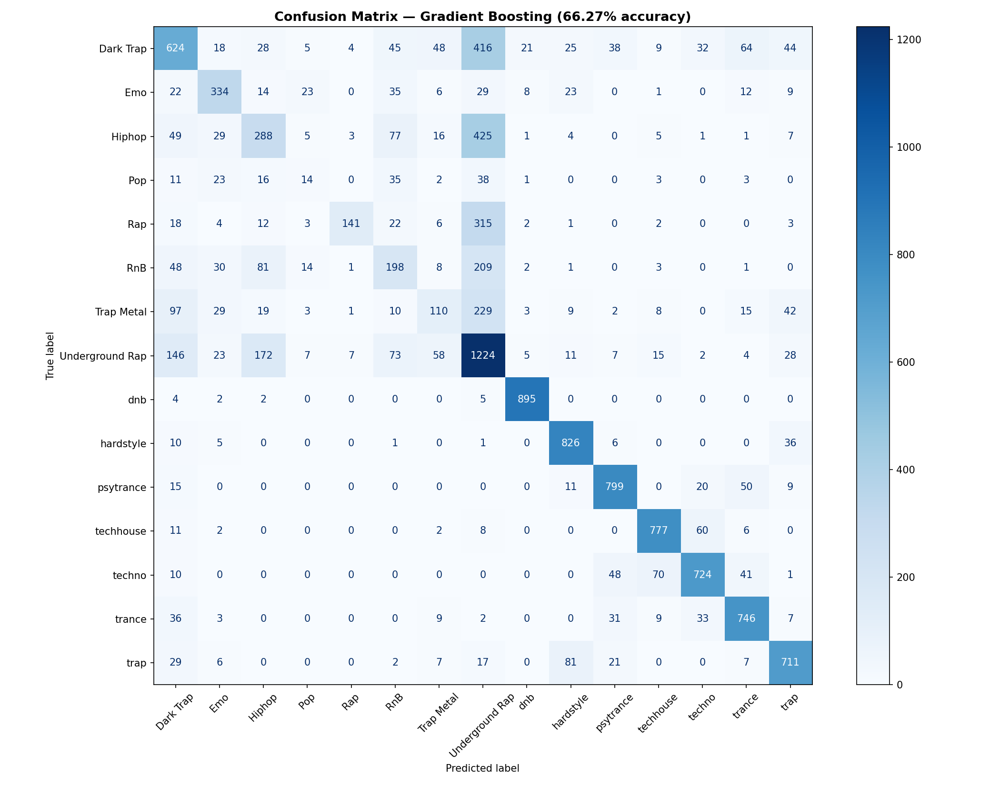
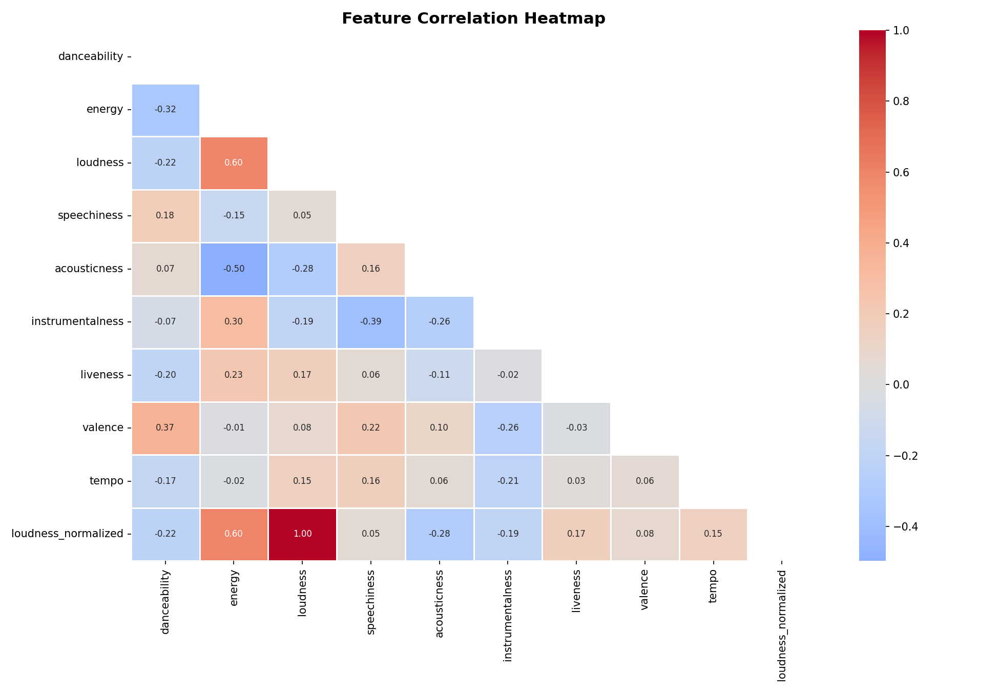
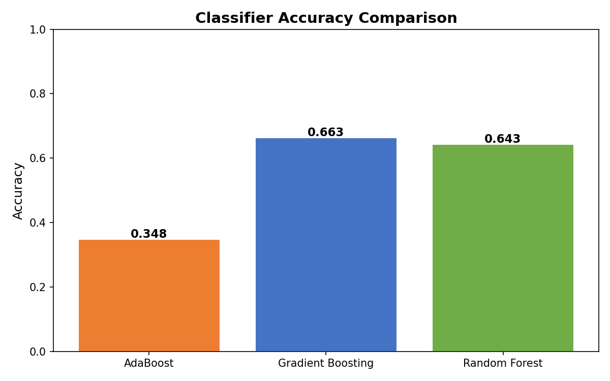

# 🎵 Spotify Genre Classifier

**Predicting music genre from audio features using ensemble machine learning, with SHAP explainability.**

University of Delhi | Shyama Prasad Mukherji College for Women | Course: Data Mining II | Group project

🔗 [Kaggle notebook](https://www.kaggle.com/code/alankriti21/spotify-kaggle-notebook) | 📊 [Dataset](https://www.kaggle.com/datasets/mrmorj/dataset-of-songs-in-spotify)

## Overview
This project analyses 42,305 Spotify tracks across 15 genres. It covers data cleaning, feature engineering, EDA, outlier handling, classifier comparison and SHAP explainability.

**Question:** Can a song's genre be predicted from its audio features alone?
**Answer:** Largely yes for electronic genres, much less for overlapping rap-related genres. Gradient Boosting reached **66.27% accuracy** (macro F1 0.61) on a 70/30 split, and tempo was the most important feature.

## My contribution
Feature engineering and SHAP analysis.

## Dataset
| Property | Detail |
|---|---|
| Source | Dataset of Songs in Spotify (Kaggle, mrmorj) |
| Files | genres_v2.csv (used); playlists.csv (loaded, not used in the analysis) |
| Size | 42,305 rows × 22 columns |
| Genres | 15 (Pop is smallest with 461 tracks; Underground Rap is largest with 5,875) |

## Pipeline
1. **Cleaning:** checked for duplicates (none found), dropped ID and index columns, label-encoded the genre target
2. **Feature engineering:** 6 derived features (energy_density, dance_mood_score, vocal_presence, duration_min, loudness_normalized, tempo_category)
3. **EDA:** correlation heatmap, distributions, genre-level statistics, interactive Plotly charts
4. **Outliers:** Z-score (threshold 3), capped at mean ± 3 standard deviations so no rows are lost
5. **Models:** AdaBoost (GridSearchCV, 5-fold CV), Gradient Boosting, Random Forest, using 12 features
6. **Explainability:** SHAP on the Random Forest

## Results
| Model | Accuracy | Macro F1 | Notes |
|---|---|---|---|
| Gradient Boosting | 66.27% | 0.61 | Best overall |
| Random Forest | 64.29% | 0.61 | Close second |
| AdaBoost | 34.80% | 0.29 | Weak on overlapping genres |

**Easiest genres (Gradient Boosting, F1):** dnb 0.97, hardstyle 0.88, techhouse 0.88, psytrance 0.86.
**Hardest genres:** Pop 0.13, Trap Metal 0.26, RnB 0.36, Hiphop 0.37. Rap-related subgenres overlap heavily, and Pop has only 461 tracks.

## Feature importance
| Rank | Feature (Gradient Boosting) | Importance |
|---|---|---|
| 1 | tempo | 46.6% |
| 2 | danceability | 10.3% |
| 3 | instrumentalness | 9.8% |
| 4 | loudness_normalized | 7.0% |
| 5 | vocal_presence | 6.8% |

## SHAP explainability
SHAP (TreeExplainer on the Random Forest, 300 test samples) shows which audio features push predictions the most.
- Tempo is the most influential feature overall (mean |SHAP| 0.036), followed by instrumentalness and danceability (about 0.019 each).
- The notebook's per-genre SHAP plot covers only the first six genres alphabetically. Extending it to all 15 is a planned improvement.

## Insights
- Electronic genres are the easiest to classify (F1 0.82 to 0.97), so they have distinct audio profiles.
- Rap-related subgenres overlap, so audio features alone are not enough to separate them.
- Songs under 90 BPM have the highest average valence (0.437).
- Songs at 90–130 BPM have the highest average danceability (0.724).

## Limitations
- **Energy regression is not valid.** The notebook also fits regression models to predict `energy`, but `energy` and `energy_density` (which is computed from `energy`) were among the inputs. This leaks the target, so the reported R² of about 0.9999 is not meaningful and is excluded from the conclusions above. It does not affect the genre classification results.
- Outlier capping used statistics from the full dataset before the train/test split, which is a minor leak.
- Results come from a single 70/30 split with no repeated runs.
- Audio features alone cannot separate overlapping genres.

## How to run
**Kaggle (easiest):** open the notebook link above, click *Copy & Edit*, then *Run All*.
**Locally:** download `spotify-genre-classification-ensemble-ml-shap.ipynb` and `genres_v2.csv`, update the file path in the second cell, and run it in Jupyter.

## Requirements
pandas, numpy, matplotlib, seaborn, scikit-learn, plotly, scipy, shap

## Team
Alankriti Jain, Riya, Manasvi Arora, Archi Aggarwal

## References
- [Scikit-learn: Ensemble Methods](https://scikit-learn.org/stable/modules/ensemble.html)
- [SHAP documentation](https://shap.readthedocs.io)
- [Kaggle dataset by mrmorj](https://www.kaggle.com/datasets/mrmorj/dataset-of-songs-in-spotify)
