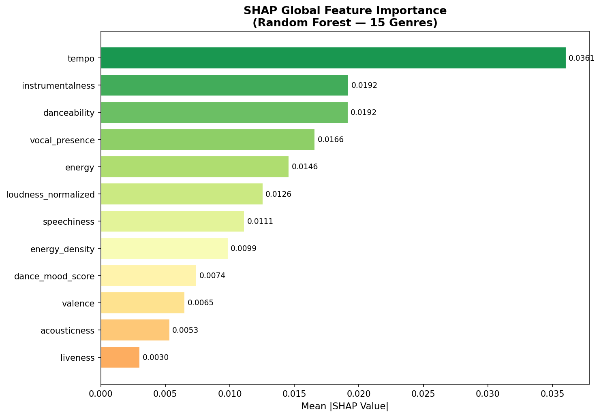
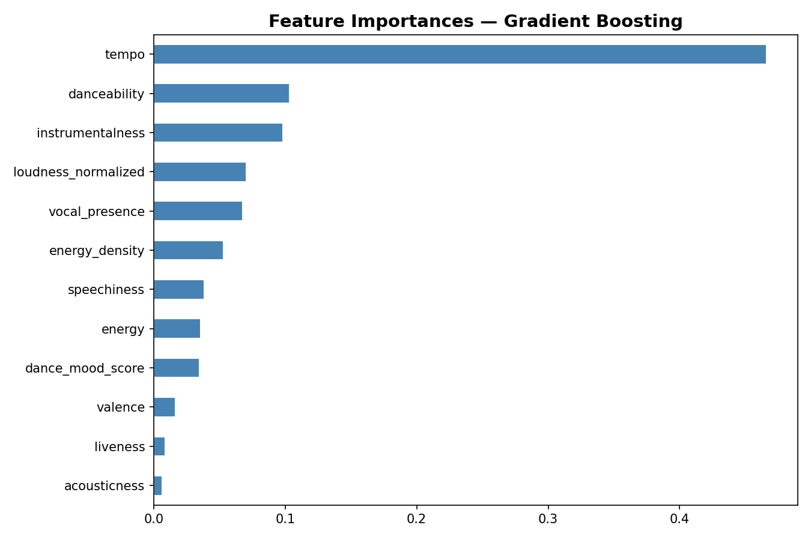

# 🎵 Spotify Genre Classifier

**Predicting music genre from audio features using ensemble machine learning, with SHAP explainability.**

University of Delhi | Shyama Prasad Mukherji College for Women | Course: Data Mining II | Group project

🔗 [Kaggle notebook](https://www.kaggle.com/code/alankriti21/spotify-kaggle-notebook) | 📊 [Dataset](https://www.kaggle.com/datasets/mrmorj/dataset-of-songs-in-spotify)

## Overview
This project analyses 42,305 Spotify tracks across 15 genres. It covers data cleaning, feature engineering, EDA, outlier handling, model comparison and SHAP explainability.

**Question:** Can a song's genre be predicted from its audio features alone?
**Answer:** Largely yes. Gradient Boosting reached **66.27% accuracy** (macro F1 0.61), and tempo was the most important feature.

## My contribution
Feature engineering, model tuning, and SHAP analysis.

## Dataset
| Property | Detail |
|---|---|
| Source | Dataset of Songs in Spotify (Kaggle, mrmorj) |
| Files | genres_v2.csv, playlists.csv |
| Size | 42,305 rows × 22 columns |
| Genres | 15 |

## Pipeline
1. **Cleaning:** removed duplicates, encoded columns, dropped unused fields
2. **Feature engineering:** 6 derived features (energy_density, dance_mood_score, vocal_presence, duration_min, loudness_normalized, tempo_category)
3. **EDA:** correlation heatmap, distributions, genre-level analysis, interactive Plotly charts
4. **Outliers:** Z-score (threshold 3) with capping, so no rows are lost
5. **Models:** AdaBoost (GridSearchCV, 5-fold CV), Gradient Boosting, Random Forest
6. **Explainability:** SHAP global, per-genre and single-prediction views

## Results
| Model | Accuracy | Macro F1 | Notes |
|---|---|---|---|
| Gradient Boosting | 66.27% | 0.61 | Best overall |
| Random Forest | 64.29% | 0.61 | Stable |
| AdaBoost | 34.80% | 0.29 | Weak on overlapping genres |

**Easiest genres (Gradient Boosting):** dnb (F1 0.97), hardstyle (0.88), techhouse (0.88), psytrance (0.86).
**Hardest genres:** Dark Trap (F1 0.49) and Pop (0.13). Rap subgenres overlap heavily, and Pop has few samples.

## Feature importance
| Rank | Feature (Gradient Boosting) | Importance |
|---|---|---|
| 1 | tempo | 46.6% |
| 2 | danceability | 10.3% |
| 3 | instrumentalness | 9.8% |
| 4 | loudness_normalized | 7.0% |
| 5 | vocal_presence | 6.8% |

## SHAP explainability
SHAP shows which audio features push a song toward each genre.
- Tempo is the most decisive feature overall.
- Electronic genres (dnb, techno, hardstyle) are separated mainly by tempo.
- Rap genres rely on speechiness and danceability.
- RnB and Pop are separated by valence and dance_mood_score.

## Insights
- Electronic genres reach 86–97% precision, so they have very distinct audio fingerprints.
- Rap subgenres overlap, so audio features alone are not enough to separate them.
- Songs under 90 BPM have the highest average valence (0.437).
- Songs at 90–130 BPM have the highest average danceability (0.724).

## Limitations
- The Bagging regression on `energy` gave R² ≈ 0.9999. This is suspiciously high. Some engineered features (such as `energy_density`) may be derived from `energy`, which would leak the target. Re-running without them is a planned improvement, so this result should not be read as a finding.
- Audio features alone cannot separate overlapping genres.

## How to run
**Kaggle (easiest):** open the notebook link above, click *Copy & Edit*, then *Run All*.
**Locally:** download `spotify-kaggle-notebook.ipynb` and `genres_v2.csv`, update the file path in the first cell, and run it in Jupyter.

## Requirements
pandas, numpy, matplotlib, seaborn, scikit-learn, plotly, scipy, shap

## Team
Alankriti Jain, Riya, Manasvi Arora, Archi Aggarwal

## References
- [Scikit-learn: Ensemble Methods](https://scikit-learn.org/stable/modules/ensemble.html)
- [SHAP documentation](https://shap.readthedocs.io)
- [Kaggle dataset by mrmorj](https://www.kaggle.com/datasets/mrmorj/dataset-of-songs-in-spotify)
